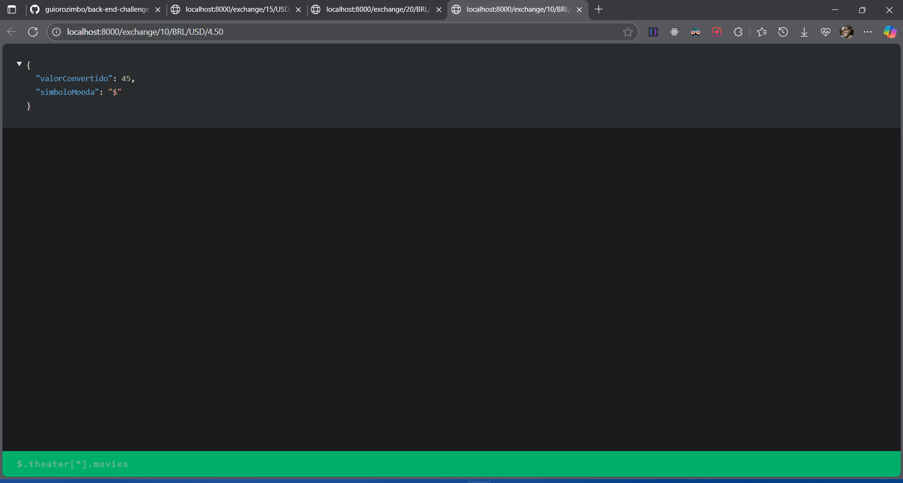
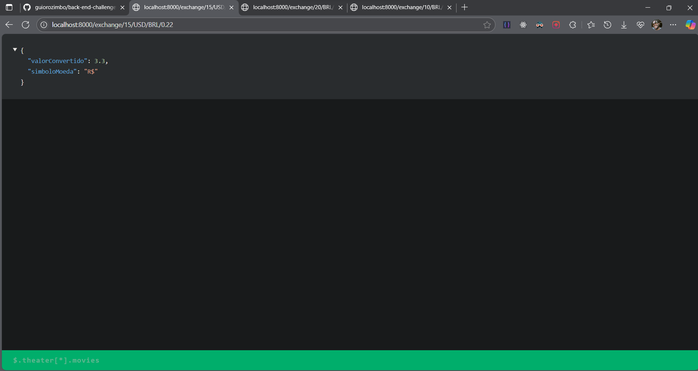
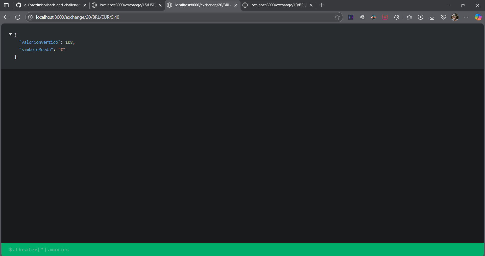
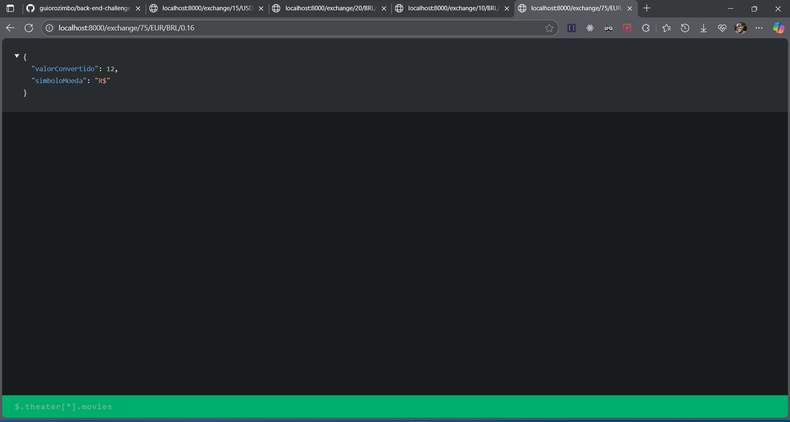
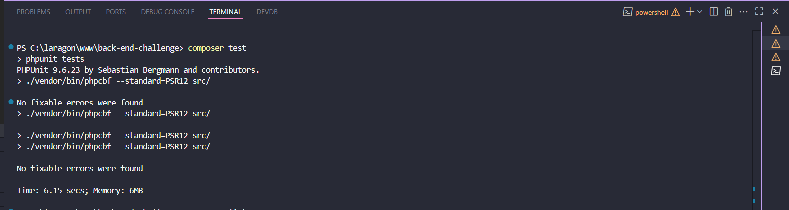
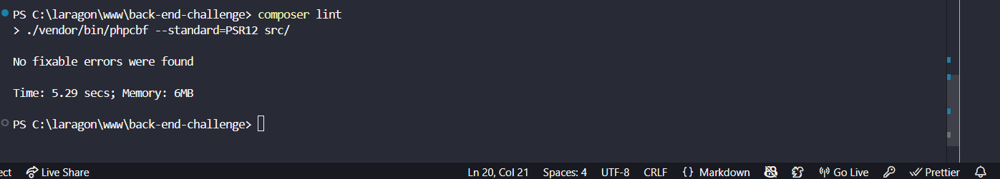

- Conversão BRL ↔ EUR
- Validação de moedas permitidas

📸 **Evidências:**

1. **API em execução (localhost):**  
     
   *Exemplo de chamada: `/exchange/10/BRL/USD/4.50`*
   

   ### 2. USD → BRL
   

   ### 3. BRL → EUR

### 4. EUR → BRL

2. **Testes passando:**  
     
   *Todos os testes OK*

3. **Análise de código:**  
     
   *Sem erros de estilo*

🔧 **Como testar:**
1. Clone o repositório
2. `composer install`
3. ` php -S localhost:8000 src/index.php`
4. Acesse os endpoints ou execute `composer test` e `composer lint`